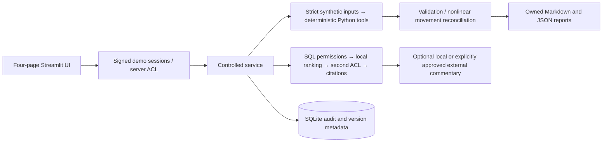

# HK RBC Actuarial Analysis & Validation Agent

[](https://github.com/woming98/hkrbc-actuarial-ai-agent/actions/workflows/verify.yml)

A local-first, working Streamlit prototype for actuarial consulting demonstrations: versioned regulatory evidence, deterministic asset analysis, diversification-aware capital movements, validation and controlled data access.

Version **0.2.0** adds directly inspected official-PDF evidence, measured bilingual retrieval, optional local semantic encoders, an explicit date/holdings/yield/spread bridge, and immutable document retirement. It remains a research prototype. See [the second-round verification record](docs/phase2-verification.md) for measured results and outstanding work.

**Synthetic data only. Educational capital approximations. Not a certified compliance solution or a production-ready system.** No claim of regulatory approval, complete HK RBC implementation or measured advantage over a general LLM.

本機示範已包含合成投資組合、四個頁面、角色權限、計算及驗證。預設毋須 API key，也不會呼叫外部模型。法規摘要附版本與來源；現行綜合法規仍須由專業人員核對。

## Run locally

```bash
python3 -m venv .venv
source .venv/bin/activate
python -m pip install '.[dev]'
python -m pytest -q
python scripts/run_demo.py
python -m streamlit run app.py --server.address 127.0.0.1 --server.port 8501 --browser.gatherUsageStats false
```

Open [the local application](http://127.0.0.1:8501). An installed app needs no network, model weights or credentials for its default workflow. Dependency installation needs package access. See [deployment instructions](docs/deployment.md) for optional model adapters and container use.

On this Mac, the prepared environment can also be started by double-clicking `Start.command`. It explicitly keeps external inference disabled. If port8501 is already in use by this demo, use the existing local application.

| Demo username | Password | Evidence access |
|---|---|---|
| `analyst` | `Demo-Analyst-2026!` | Public |
| `reviewer` | `Demo-Reviewer-2026!` | Public + internal |
| `admin` | `Demo-Admin-2026!` | Public + internal + restricted |

These credentials are intentionally public. This is a local role demonstration, not enterprise authentication. Set environment password overrides before any shared use.

## Business problem and value

An actuarial analysis needs defensible sources, consistent inputs, traceable calculations and reconciliation. A persuasive chatbot answer alone does not establish any of those. This prototype places a service boundary around evidence and deterministic tools: it can refuse an unsupported current-law claim, block an invalid portfolio, keep restricted evidence away from an analyst and show exactly how a nonlinear capital movement reconciles.

The intended demonstration is for actuarial consultants, insurance risk professionals and technical reviewers. The system does not aim to outperform a general LLM's reasoning or replace actuarial judgment. There is no LLM in the authoritative calculation path.

## Demonstration workflow

1. Sign in as `analyst`. In **Regulatory Assistant**, ask “When did the RBC regime commence?” or “HK RBC 何時實施？” Inspect official URLs, sections, publication/review dates and version limitations. Ask for a current regulatory correlation matrix: the result explicitly reports insufficient evidence.
2. Open **Capital Analysis** and load the bundled synthetic data. Run the opening/closing comparison. Inspect module stresses, Shapley attribution, diversification and residual. Run seeded illustrative scenarios and download a Markdown report plus its detailed JSON calculation records.
3. Open **Validation Dashboard**. Validation is deterministic and separate from commentary. Upload `data/portfolios/malformed.csv` to trigger an input failure; a material unexpected capital movement also blocks completion. A failed result cannot be presented as complete.
   The `coupon_crossing_opening.csv` / `coupon_crossing_closing.csv` pair demonstrates a subtler failure: risk-module arithmetic reconciles, but missing coupon settlement prevents completion of the factor bridge.
4. Open **Governance & Audit**. The analyst sees public documents and their own audit. Sign out and use `reviewer` to inspect internal synthetic methodology; only `admin` can see the restricted synthetic marker and ingest new document versions. Raw prompts are absent from audit.

The sample portfolio produces approximately:

| Measure | HKD |
|---|---:|
| Opening illustrative capital | 20,224,927.84 |
| Closing illustrative capital | 22,615,906.43 |
| Movement | 2,390,978.59 |
| Reconciliation residual | 0.00 |

These are actual deterministic outputs for the bundled fixtures, not statutory RBC results. Standalone module changes do not sum to the diversified movement; exact Shapley allocations do. See the [example report](reports/example-actuarial-report.md) and [methodology](docs/actuarial-methodology.md).

## Architecture



The lightweight architecture uses Python3.11+, Pydantic, NumPy, Streamlit, pandas, pytest and SQLite. Default retrieval uses field-weighted BM25 with Chinese tokenization, bilingual aliases, exact rule identifiers and diversity reranking. Optional `dense` and `hybrid` modes use real, independently provisioned local SentenceTransformers weights; the application never downloads weights. A legacy hash ranker remains available for measured comparison. All methods filter permissions before encoding. Chroma/FAISS and LangGraph are not required for this small corpus. Optional Ollama and OpenAI adapters add commentary with no authority over calculations or citations. See [architecture decisions](docs/architecture.md) and [retrieval measurements](docs/retrieval-evaluation.md).

## Regulatory sources and versioning

The corpus contains 22 short researcher paraphrases with official links, plus three clearly marked synthetic access/version fixtures. The original 13-record seed is preserved unchanged. Twelve supplementary records were checked against actual official 2024 and 2026 LegCo-hosted Gazette PDFs, with file SHA256, one-based PDF page, printed section and verification date. Original-law baselines and future amendments are explicit. Source verification records distinguish inspected PDF bytes from earlier official search-index evidence. PDFs, full extracts and page images remain in an ignored local research cache and are excluded from distribution. See [the primary-source verification record](docs/source-verification-2026-10-25.md).

Core sources include the [inspected original 2024 Cap.41R gazette PDF](https://www.legco.gov.hk/yr2024/english/subleg/negative/2024ln062-e.pdf), [2024 commencement announcement](https://www.info.gov.hk/gia/general/202405/03/P2024050300187p.htm), [2025 disclosure template](https://www.ia.org.hk/en/legislative_framework/circulars/reg_matters/files/Circular_20250808_Annex_1.pdf) and [inspected 2026 amendment PDF](https://www.legco.gov.hk/yr2026/english/hc/sub_leg/sc04/papers/2026ln058-e.pdf). Direct IA PDF access was refused during this check, and the legacy Gazette route returned HTML; the source register distinguishes those failures from the successful LegCo downloads.

The 2026 announcement distinguishes public-disclosure commencement on gazettal from review amendments scheduled for 31 December 2026. The seed preserves this distinction and does not treat future changes as already operative. **No seed record claims verified current consolidated law.** The [official Cap.41R consolidation](https://www.elegislation.gov.hk/hk/cap41R) and subsequent amendment history must be checked before real reliance. Historical/conceptual retrieval works; current-law and unsupported calibration requests report insufficient evidence. See the [research and access limitations](docs/regulatory-research.md).

Document IDs and versions are immutable. Administrators can retire an old version and record a successor without rewriting source bytes. Retired/superseded records are excluded before retrieval; authorized users can still inspect history. Classification filtering occurs before embedding and again after retrieval. Oversized sections split within the same section. Existing document versions cannot be silently overwritten.

## Actuarial tools and validation

Implemented tools include dated annual-coupon bond PV, Macaulay/modified duration, analytic DV01, interpolated key-rate durations, interest-rate/spread/equity stresses, asset aggregation, exact three-module Shapley attribution and seeded illustrative economic shocks. Every result carries versioned inputs, outputs, assumptions, limitations and validation checks.

The additional [factor bridge](docs/movement-attribution.md) first ages opening positions at opening quotes, then averages all six replacement orders across holdings/equity values, risk-free yields and credit spreads. It records all eight hybrid states. Missing coupon/maturity settlement or changes to same-ID instrument terms block completion under the default policy. Equity quantities, prices and flows cannot be separated from market values alone; this is a counterfactual model attribution, not proof of transaction causality.

The stress model uses ±100bp rate, +100bp spread and -30% equity shocks, then a documented internally chosen positive-definite correlation matrix. These are educational assumptions, not official calibrations. There are no liabilities, capital resources, matching adjustment, rating-specific factors, tax, FX/default/operational/concentration risks, statutory floors or full prescribed aggregation. Scenario repricing is not a calibrated regulatory ESG.

Validation covers missing/duplicate/unsupported data, invalid or nonfinite assumptions, negative/inconsistent values, supplied bond-mark reconciliation, monotonicity, KRD reconciliation, independent capital aggregation, movement reconciliation, material unexpected movements and scenario integrity. Failed checks block completion; no model can override them. Detailed [actuarial methodology](docs/actuarial-methodology.md) specifies units, dates, thresholds and caveats.

## Privacy and governance

Every service call checks a signed role session. Default external processing is disabled. An external request requires server opt-in, reviewer/admin permission, literal per-request approval, public-only evidence, DLP acceptance and configured credentials/model; no silent fallback occurs. Portfolio data never goes to a model.

Basic PII redaction covers common email/HKID/telephone/card/secret patterns, with strict synthetic CSV validation. Document instructions cannot execute tools. Audit metadata records demo identity, UTC time, document versions, calculation functions/versions, validation status, provider and report ID, excluding raw prompts and uploads. Local reports retain synthetic inputs for calculation traceability.

The database is plaintext and logs are not tamper-proof. Public demo passwords, incomplete pattern-based DLP, one shared workspace, missing SSO/tenant isolation and unverified vendor retention are explicit limitations. See the [security design and threat model](docs/security-and-privacy.md).

## Repository review and reuse

The four requested repositories were inspected at pinned commits: [notes](https://github.com/woming98/hkrbc-notes), [ESG](https://github.com/woming98/hkrbc-esg), [asset model](https://github.com/woming98/hkrbc-asset-model) and [IFRS17 subledger](https://github.com/woming98/ifrs17-subledger). No upstream repository was modified. License grants were insufficiently documented for dependable source reuse; this project contains independently implemented formulas and documented future adapter interfaces. It does not present upstream educational capital calculations as compliant. Full evidence is in the [repository review](docs/repository-review.md).

## Evaluation and evidence

```bash
python evaluation/run.py
```

The evaluation manifest includes identical case definitions, independently specified numerical expectations, citation-reference checks, reconciliation, disclosure, timing and reproducibility checks. Offline workflow C has measured results in `evaluation/results/`; A (LLM+documents) and B (same LLM+equivalent tools) are explicitly **not run** unless real result files with required provider/model/configuration metadata are supplied. There is no claim of comparative performance or same-model equivalence for the deterministic offline C run. Citation ID/source checks do not establish semantic entailment. See [evaluation instructions and results](evaluation/README.md).

A separate 44-question developer diagnostic set compares hash, BM25, dense and hybrid ranking on the same versioned corpus. It reports recall/MRR, English/Chinese groups, unsupported/current-law abstention, unauthorized retrieval and the joint presence of a relevant section with an answerable status. This is a small diagnostic set used during development, not an independent held-out or LLM benchmark. Model revisions, corpus/case hashes and raw per-question results are recorded. See [retrieval evaluation](docs/retrieval-evaluation.md).

Unit, integration, security and Streamlit AppTest tests can run without paid calls. The [second-round verification](docs/phase2-verification.md) and [initial verification snapshot](docs/verification.md) record the tested environment, actual commands/results and untested integrations.

[View the actual local interface screenshot](reports/app-preview.jpg).

## Project map

```text
app.py                         Four-page Streamlit application
src/hkrbc_agent/                Service, security, retrieval, storage, calculations, reports
data/documents/                 Versioned source paraphrases and research metadata
data/portfolios/                Synthetic opening, closing and malformed examples
tests/                         Numerical, integration, security, retrieval, UI and evaluation checks
evaluation/                    Cases, expected results, runner, baseline adapter and measured outputs
scripts/run_demo.py             Local end-to-end demo and report generation
reports/                       Example Markdown report and complete JSON records
docs/                          Architecture, methodology, privacy, source review and deployment
```

The original application code is public for portfolio inspection; no open-source redistribution license has been assigned. Source-document rights remain with their publishers. No original upstream code, confidential employer data, real client files, API keys or paid benchmark outputs are included. The repository is public on GitHub at the author's request. No public application deployment or paid API call was performed.
