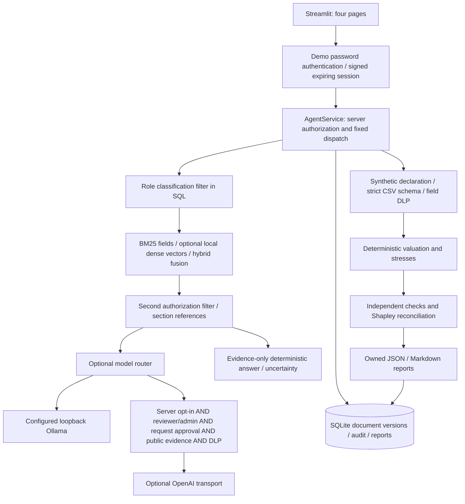

# Architecture and implementation decisions

This is a working local prototype, not a certified compliance product. The runtime uses one controlled service and fixed calculation functions. Development assistants are not part of the application architecture.

## Boundaries

`security.py` authenticates three demonstration users and defines server permissions. `service.py` is the application boundary: every exposed operation resolves a signed token and checks permissions. `store.py` persists immutable document versions, owned report payloads and allowlisted audit metadata. Portfolio inputs are never routed to LLMs.

`retrieval.py` receives only authorized document payloads from SQLite and applies an independent classification check before all ranker/encoder work. Default field-weighted BM25 supports Chinese bigrams, curated bilingual aliases and precise rule identifiers. Diversity reranking reduces redundant sections. The legacy hash method remains a comparison baseline. Optional local SentenceTransformers safetensors provide real semantic vectors; `hybrid` combines lexical and dense ranks using reciprocal-rank fusion. Semantic configuration fails closed when files/dependencies/integrity checks fail. No document/query vector cache is shared across roles or persisted. The small exact in-memory corpus needs no FAISS/Chroma service. Recall, answer-scope and authorization metrics are evaluated separately; relevance is not legal entailment.

Each ingested record represents one named source section. Oversized records split within that section; citation metadata remains attached. Batches are prevalidated and inserted atomically. Changed content cannot overwrite an existing `(document_id, version)`. Archived versions remain inspectable but are excluded from ordinary retrieval. A SHA-256 payload check detects accidental document corruption; it does not defend against an administrator able to rewrite the database.

Retirement decisions live in a separate append-only table, preserving the exact immutable source payload. SQL excludes retired versions before deserialization. A curator may name an existing, nonquarantined, nonsuperseded successor; decisions are immutable and idempotent even when the successor is later retired. Protected successor IDs are omitted from lower-role history. Existing databases gain the retirement table without rewriting old payload/checksums, and newly added optional provenance defaults preserve legacy serialization.

The offline answer renderer attaches only retrieved reference IDs, source URLs, dates, sections and version limitations. It never asks a model to invent references. Current-law and regulatory-calibration questions return explicit insufficient-evidence status when the seed corpus cannot establish them. Optional model prose is displayed separately as unverified commentary. No model can choose tools or calculate authoritative figures.

`calculations.py` contains original formulas. `portfolio.py` validates both direct typed inputs and CSV uploads. The same engine produces UI metrics, validation checks and report payloads. Fixed dispatch avoids executing model-proposed code or dynamic imports. Failed checks yield a blocked result; invalid files raise a controlled validation exception.

## Stages and verification

1. Review four upstream repositories and licenses before choosing original implementations. See `repository-review.md` for pinned commits and evidence.
2. Implement dated bond cashflows, stress modules, nonlinear aggregation, attribution and validated sample inputs. Numerical tests use analytical prices/derivatives and independent aggregation identities.
3. Add signed sessions, SQL permissions, post-filtering, PII controls, injection rejection, model gates and metadata-only audit. Test attempted bypasses.
4. Add a case manifest and honest offline evaluation. The two same-LLM baselines remain unrun without externally supplied results; offline results are not a same-model comparison.
5. Add the four UI pages, report exports, deployment instructions and reproducible demo. AppTest exercises actual Streamlit control flow.

## Extension seams

Upstream ESG/asset/subledger functions are reviewed adapter candidates only. No upstream source was copied. A future adapter must specify its license, pinned version, field units, scenario shape, limits and independent acceptance tests. Add liabilities, rating-dependent stresses, official version ingestion and prescribed aggregation only after source and methodology review. Real authentication, encrypted persistence, tenant separation, enterprise DLP, hardened hosting and external approval retention are deployment work beyond this prototype.
